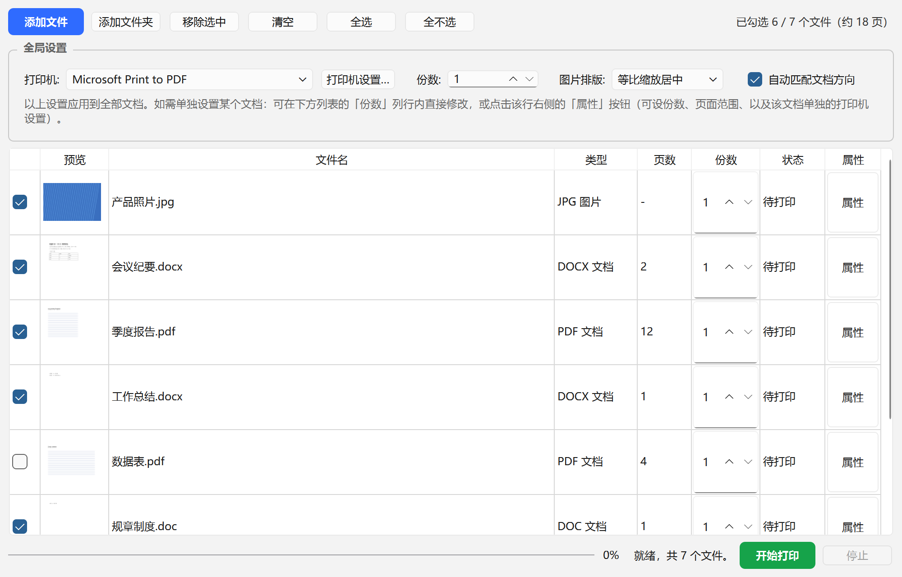

# 批量打印 (BatchPrint)

Windows 桌面工具，用于**批量打印 PDF、图片和 Word 文档**。可调用打印机原生设置并应用到全部文档，也支持对单个文档单独设置。



## 下载

免安装绿色版见 [Releases](https://github.com/kostya-sheng/batch-print/releases)：下载 zip 解压后，
双击 `批量打印.exe` 即可运行，无需安装 Python。

详见开发蓝图：[批量打印应用_开发蓝图.md](批量打印应用_开发蓝图.md)

## 功能

### 1. 导入文件

- 三种方式：**拖拽**文件/文件夹到窗口、**添加文件**（可多选）、**添加文件夹**（递归扫描所有子目录）
- 支持格式：
  - **PDF**：`.pdf`
  - **图片**：`.jpg` `.jpeg` `.png` `.bmp` `.tif` `.tiff` `.gif`
  - **Word 文档**：`.docx` `.doc`（需要本机安装 Microsoft Word 或 WPS，见第 6 节）
- 自动**去重**：同一个文件不会被重复添加
- 扫描文件夹时自动跳过 Word 的临时锁文件（`~$` 开头）
- 自动识别页数（Word 文档在后台转换完成后显示）
- **全程不卡界面**：扫描目录、读页数都在后台线程完成，再分批插入列表；
  过程中状态栏依次显示「正在扫描… X/Y」→「正在加载… X/Y」，导入几百个文件也能随时点

### 2. 文件列表

列表共 8 列：**勾选 / 预览 / 文件名 / 类型 / 页数 / 份数 / 状态 / 属性**

- **勾选**：只有勾选的文件会被打印
- **预览**：首页缩略图。**只渲染屏幕上可见的行**，滚到哪生成到哪（文件再多也不卡）
- **类型**：`PDF 文档`、`DOCX 文档`、`DOC 文档`、`JPG 图片`…（按实际扩展名显示）
- **份数**：可**直接在行内修改**。加粗 = 已为该文档单独设置（不再跟随全局）；常规字重 = 跟随全局
- **状态**：待打印 / 打印中 / 完成 / 失败，Word 文档另有 转换中 / 转换失败。
  - 失败类状态显示为**红字**，鼠标悬停可看原因
  - **转换失败的文件自动取消勾选**（打不出来，不计入统计）；打印失败的保持勾选，方便直接重打
- **属性**：打开该文档的独立设置窗口（见第 5 节）
- 工具栏右侧常驻**统计**：`已勾选 12 / 95 个文件（约 240 页）`，页数已算入份数
- 列表操作：移除选中 / 清空 / 全选 / 全不选

### 3. 全局设置（应用到全部文档）

界面上用灰色边框单独框出，与单文档设置区分：

- **打印机**：枚举本机所有打印机（含网络打印机），默认选中系统默认打印机
- **打印机设置…**：调出**打印机自带的原生属性对话框**——双面、彩色/黑白、纸张大小、纸盒来源等
  由打印机驱动自己提供，设置结果应用到所有文档
- **份数**：应用到所有未单独设置份数的文档
- **图片排版**：
  - `等比缩放居中`（默认）：完整显示，不裁切
  - `等比铺满(裁切)`：铺满纸张，超出部分裁掉
  - `拉伸铺满`：拉伸填满，不保持比例
- **自动匹配文档方向**（默认开启）：横向的页面/图片自动用横向打印，纵向的用纵向。
  PDF 和 Word 文档**逐页判断**，同一份文档里混合方向也能各自匹配。关掉则一律用你手动设的方向
- 切换打印机时会自动重置打印机设置（旧设置属于旧打印机，不通用），状态栏有提示

### 4. 单文档设置（覆盖全局）

任何一项**不设置就继承全局**：

- **份数**：列表行内直接改，或在属性窗口里设
- **页面范围**（PDF 和 Word 文档）：如 `1-3,5`；留空 = 全部页
- **单独的打印机设置**：为该文档单独调出打印机原生对话框，与全局**互不影响**
- 可随时「恢复继承全局」

### 5. 属性窗口（逐页预览）

- **大图预览**（420px），不是小缩略图
- **翻页导航**：`◀ 上一页` / `第 [n] / N 页`（可直接输入页码跳转）/ `下一页 ▶`，
  能看到 PDF 和 Word 文档的每一页（Word 文档预览的就是实际会打印的排版）
- 按需渲染当前页并缓存，打开上百页的文档也不卡
- Word 文档还在转换时，预览区提示「正在后台转换」；转换失败时显示原因
- 设了「页面范围」时，预览下方实时提示当前页 **「本页在打印范围内」**（绿）或
  **「本页不在打印范围内，不会打印」**（橙）
- 图片只有一页，自动隐藏翻页控件

### 6. Word 文档（.docx / .doc）

Word 文档没有固定的"页"，排版要靠 Word 现算。本程序在**后台**调用本机的 Word 把文档导出成 PDF，
再走和 PDF 完全相同的流程（预览、页面范围、自动方向、打印机设置都通用）。

- **需要本机安装 Microsoft Word 或 WPS**。优先用 Word，Word 不可用时自动改用 WPS；
  都没装的话，Word 文档标为「转换失败」，PDF 和图片照常可用
- **全程看不到 Word 窗口**：Word 以隐藏方式运行，关闭所有提示、禁用宏、只读打开，不会改动原文件，
  也不会出现在 Word 的「最近使用」里
- **不影响你自己正在用的 Word / WPS**：程序新开独立的后台实例，绝不接管或关闭你打开的文档
- **导入后立即在后台转换**，状态栏显示「正在转换 Word 文档 X/Y」，每转完一个补上页数和缩略图；
  首个文档约需 1–2 秒（后台启动 Word），之后每个通常不到 1 秒
- **修订和批注默认不打印**，打印的是接受全部修订后的最终稿
- **网络盘上的文档**（如映射的网络驱动器、`\\服务器\共享`）先复制到本地再转换，更稳定也更快
- 这些情况会直接标为「转换失败」并给出原因，**不会弹窗卡住**：
  文档有打开密码 / 权限保护、文件损坏或不是有效的 Word 文档、空文件、Word 超过 60 秒无响应
- 转换结果缓存在 `%LOCALAPPDATA%\BatchPrint\cache\word`，同一文件再次导入秒开；
  原文件修改后自动重新转换；缓存 7 天未用或总量超过 1 GB 时自动清理

### 7. 打印

- 严格**按列表顺序串行**打印（顺序可控，不会乱序）
- 每个文件是**独立的打印任务**，不合并
- 底部进度条 + 状态栏显示当前正在打印的文件
- 可随时**停止**（完成当前文件后停止）
- 失败的文件标记为「失败」并记录原因，不影响后续文件继续打印
- Word 文档如果开始打印时还没转换完，会插队转换、等它转完再打
- 打印引擎：Windows **GDI + DEVMODE** 管线。PDF 用 PyMuPDF 逐页渲染、图片用 Pillow，
  Word 文档打印的是转换出的 PDF，统一绘制到带 DEVMODE 的打印机 DC 上；
  自动方向通过逐页 `ResetDC` 实现

### 不做的事（当前版本）

- 不保存打印预设，也不记录历史
- 打印机设置（DEVMODE）仅在本次会话内有效，重启程序后回到打印机默认
- 统计里的页数是**约值**：双面打印时实际张数会减半，驱动层设置本程序无法感知；
  Word 文档转换完成前按 1 页计
- 「打印 Word 修订和批注」的开关已在代码里预留（`print_markup`），界面上暂未开放
- 不支持 `.rtf`、WPS 自有格式 `.wps`、Excel、PPT

## 环境

- Windows 10/11，Python 3.11+
- 依赖见 `requirements.txt`：PySide6 / PyMuPDF / Pillow / pywin32
- 打印 Word 文档需要本机安装 Microsoft Word 或 WPS（不打包进程序）

## 安装

```powershell
pip install -r requirements.txt
```

> **注意**：PySide6 目录层级很深，若安装时报 `OSError: [Errno 2] ...` 或长路径错误，
> 需要启用 Windows 长路径支持（管理员 PowerShell）：
> ```powershell
> New-ItemProperty -Path "HKLM:\SYSTEM\CurrentControlSet\Control\FileSystem" `
>   -Name "LongPathsEnabled" -Value 1 -PropertyType DWORD -Force
> ```
> 然后重新执行安装。

## 运行

```powershell
python run.py
```

## 目录结构

```
batchprint/
├── app.py              程序入口
├── logging_setup.py    日志
├── core/
│   ├── importer.py     文件导入/扫描
│   ├── scanner.py      后台扫描线程（展开目录/读页数，带进度）
│   ├── converter.py    Word 转 PDF（后台隐藏 Word，串行转换，带缓存与超时保护）
│   ├── settings.py     数据模型（全局/单文档设置、任务）
│   ├── printers.py     打印机枚举、原生设置对话框(DEVMODE)
│   ├── engine.py       打印引擎（GDI + DEVMODE，核心）
│   ├── runner.py       后台调度线程
│   └── thumbnailer.py  异步缩略图
└── ui/
    ├── main_window.py       主窗口
    └── properties_dialog.py 单文档属性对话框
```

## 打包（绿色/免安装）

用 PyInstaller 打成**目录版（onedir）**——整个 `dist/批量打印/` 文件夹拷到任意位置，
双击里面的 `批量打印.exe` 即可运行，目标机器无需安装 Python。

```powershell
python -m PyInstaller --noconfirm --clean 批量打印.spec
```

产物：`dist/批量打印/`（约 187 MB）
- `批量打印.exe`：启动器（约 10 MB）
- `_internal/`：所有依赖（Qt、PyMuPDF、pywin32 等）——**不要单独移动 exe，要连同 _internal 整个文件夹一起拷贝**

> 说明：exe 未做代码签名，别人首次运行可能弹 SmartScreen 提示，点「更多信息 → 仍要运行」即可。
> 出错日志在 `%APPDATA%\BatchPrint\logs\batchprint.log`。

## 开发注意事项（踩过的坑）

改动 UI / 缩略图相关代码时请留意，以下几条是排查卡顿时定位到的，改回去会重新引发界面"未响应"：

1. **QPixmap 只能在 GUI 线程用**。工作线程里一律只产出 `QImage`，QPixmap 在主线程转换
   （见 `core/thumbnailer.py`）。曾经在工作线程调 `QPixmap.fromImage()`，导致导入 95 个文件
   时主线程被锁死约 4 秒。
2. **不要一次性渲染所有缩略图**。缩略图是 Python 线程里跑 PyMuPDF，会长时间持有 GIL 把主线程
   饿死。现在只渲染可见行（`_request_visible_thumbs`）——95 个文件只渲染约 10 个，
   主线程最长阻塞从 3952ms 降到约 25ms。同理，属性窗口的预览也是按需渲染当前页。
3. **表格列宽别用 `ResizeToContents`**（文件名列的 Stretch 除外）。每次缩略图到位都会重新
   测量所有行，行一多就是 O(行数²)。

Word 转换相关（`core/converter.py`）：

4. **和 Word 交换的文件必须放在 `%TEMP%`，不能放在 `%LOCALAPPDATA%`**。用微软商店版 Python
   运行源码时，程序写进 AppData 的文件会被系统重定向到商店应用的私有目录：Python 看得到，
   Word 看不到，表现为「找不到此文件」「目录名无效」。测试时也要把缓存放在 AppData 下，
   放在 Temp 里会绕过重定向、测不出这个问题。
5. **Word 的 COM 接口是单线程的**：只用一个转换线程串行转换，不要并发。
6. **不能碰用户自己的 Word / WPS**：只用 `DispatchEx` 新开实例；超时强杀只杀启动时记下的 PID；
   关闭前检查实例里有没有用户的文档，有就把窗口交还给用户，不关闭。
7. **转换前先检查文件头**。格式不明的文件交给 Word，它会当纯文本硬读，损坏文件会被
   "转换"成几十页乱码，空文件会变成一页白纸。

## 实现状态

- [x] M0 骨架 / M1 导入+列表 / M2 打印机+设置 / M3 打印引擎（已用「打印到 PDF」端到端验证）
- [x] M4 批量串行调度、进度、停止 / M5 单文档设置
- [x] M6 打磨与 PyInstaller 打包（onedir 绿色版）
- [x] M7 Word 转换器 / M8 接入界面全链路 / M9 打包（v0.2.0，Word 文档支持）

## 许可证

[MIT](LICENSE)
